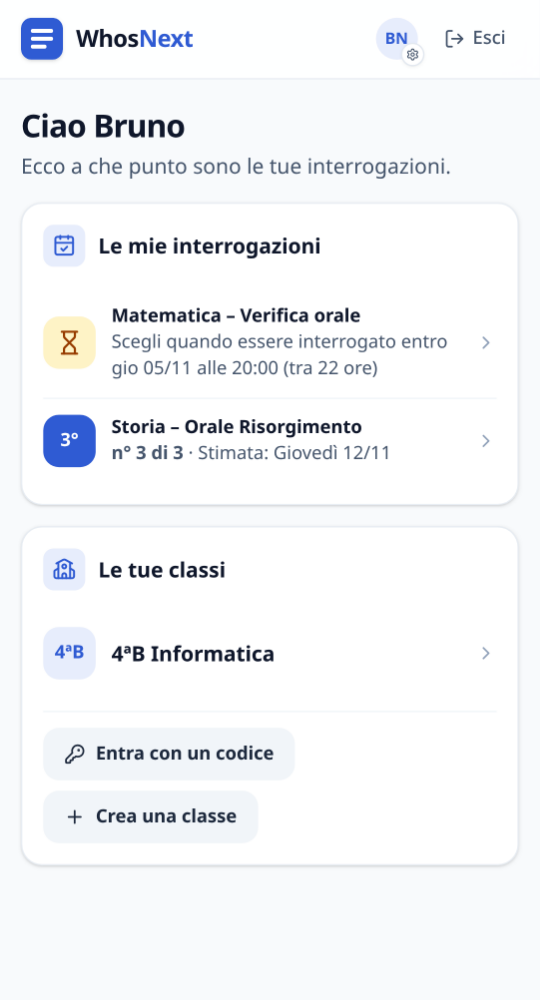
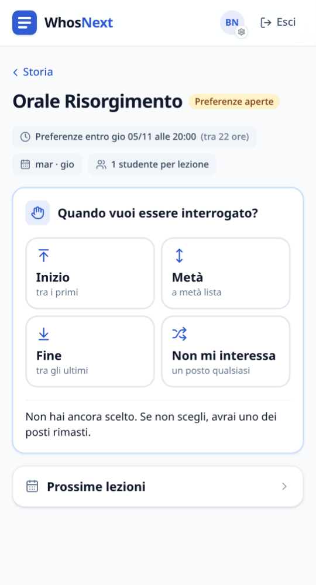
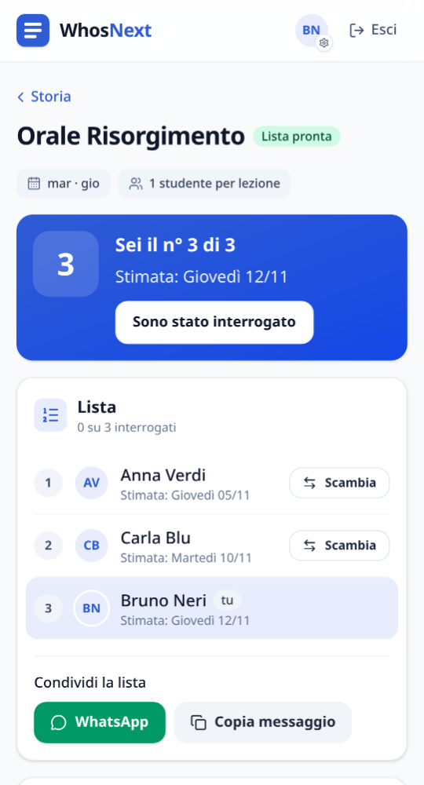
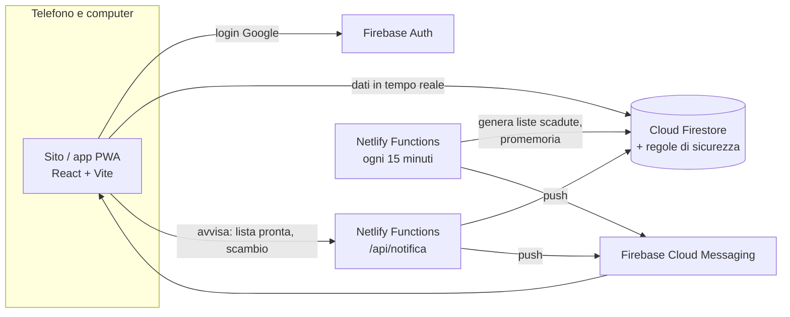

<div align="center">


# WhosNext

**L'ordine delle interrogazioni della classe, senza discussioni.**

Ognuno sceglie se vuole essere interrogato all'inizio, a metà o alla fine; WhosNext genera la lista,
stima la data per ciascuno e la tiene aggiornata con vacanze, lezioni saltate e scambi tra compagni.


</div>

<p align="center">
  
  &nbsp;
  
  &nbsp;
  
</p>

---

## Come funziona

1. **Il capoclasse crea la classe** e invita i compagni con un codice, un link o un QR code.
2. **Configura materie, orario e calendario**: giorni di lezione, vacanze, lezioni saltate.
3. **Apre un'interrogazione**: ognuno sceglie *inizio*, *metà* o *fine* entro la scadenza.
4. **Alla scadenza la lista si genera da sola**, con un sorteggio equo che rispetta le preferenze, e ognuno vede la sua posizione e il giorno stimato.

## Funzioni

### Per gli studenti
- **Le mie interrogazioni**: in un colpo d'occhio, per tutte le materie, la tua posizione e la data stimata.
- **Da fare**: cosa scegliere, entro quando, e le richieste di scambio da guardare.
- **Scambi di posto**: chiedi a un compagno di scambiare la posizione; basta che lui accetti. Massimo una richiesta aperta alla volta, e chi non vuole essere disturbato può rifiutarle tutte in automatico.
- **Notifiche sul telefono** e **Notification Box** nel sito: nuova interrogazione, lista generata, richiesta di scambio, "domani sei interrogato" (o "possibile", se non si sa chi tocca) e, al capoclasse, le conferme di chi si è segnato da solo.
- **Giorno scelto per DSA/BES**: chi ha il badge sceglie il giorno dell'interrogazione tra le lezioni disponibili; se quel giorno non viene interrogato, passa alla lezione dopo (dall'ora di uscita). Il badge è nascosto ai compagni, a meno che lo studente non scelga di mostrarlo.
- **Feedback** direttamente dalle Impostazioni.

### Per il capoclasse e il vice
- **Configurazione guidata** della classe nuova, orario a griglia, calendario con vacanze e lezioni saltate.
- **Generazione della lista** automatica alla scadenza (o subito, a mano), segna chi è stato interrogato (solo capoclasse e vice).
- **"Usa lista" facoltativa**: se il docente non vuole un ordine, si tiene solo conto di chi è stato interrogato.
- **Modifica della lista** a piacere: trascina i nomi o mandali in fondo con un tocco, poi conferma.
- **Escludi studenti** prima della generazione (vale anche per quella automatica) e **imprevisti** dopo: rimettere in lista chi era fuori o è entrato in classe dopo, fissare l'interrogazione di qualcuno in un giorno preciso, togliere chi non deve più esserci. Tutto finisce nello storico.
- **Calendario con l'ora di uscita** per ogni giorno: da quell'ora la lezione conta come fatta e le date si aggiornano. Il giorno in cui si crea un'interrogazione non conta.
- **Storico delle modifiche**: chi ha generato, spostato o segnato cosa, sempre visibile a tutta la classe.
- **Messaggi pronti per WhatsApp**: invito, promemoria per chi non ha scelto, annuncio della lista.
- **Gestione della classe**: vice, permessi dei docenti, cessione del ruolo di capoclasse.

### Per i docenti
- Accesso con l'account della scuola in sola lettura alle liste delle proprie classi; il capoclasse può dare il permesso di modificarle.

### Ovunque
- **App installabile** sul telefono (Android e iPhone) e apertura veloce anche senza rete.
- **Tema chiaro e scuro**, conferme con "Annulla", animazioni leggere (disattivate se il sistema chiede meno movimento).
- **Accesso solo con l'account della scuola** (`@studenti.ittsrimini.edu.it`, `@ittsrimini.edu.it`).

## Idee per il futuro

Funzioni possibili, raccolte durante lo sviluppo. Suggerimenti benvenuti nelle [issue](https://github.com/Sgabello-0/whosnext/issues).

### Liste e interrogazioni
- [ ] **Sorteggio con memoria**: chi è stato tra i primi nell'ultima interrogazione ha più probabilità di finire avanti nella prossima.
- [ ] **Assenti**: chi era assente il giorno della sua interrogazione torna in coda (o al primo posto libero) con un tocco.
- [ ] **Interrogazioni a coppie o a gruppi**, con le coppie scelte dagli studenti o sorteggiate.
- [ ] **Numero di interrogati variabile** lezione per lezione (es. 2 il martedì, 3 il giovedì).
- [ ] **Programma per ognuno**: argomento assegnato a ciascuno insieme alla posizione.

### Condivisione
- [ ] **Lista come immagine** pronta da mandare sul gruppo della classe.
- [ ] **Esporta nel calendario** del telefono (Google Calendar, Apple Calendar) con la data stimata.
- [ ] **Versione da stampare** per il docente.

### Scambi
- [ ] **Niente scambi nelle ultime 24 ore** prima dell'interrogazione.
- [ ] **"Cedo il mio posto"**: un posto offerto a tutta la classe, al primo che lo prende.
- [ ] **Scambi a tre**, quando nessuno dei due vuole il posto dell'altro ma un terzo sì.

### Notifiche
- [ ] **Al capoclasse quando tutti hanno scelto**, per generare subito la lista.
- [ ] **Promemoria per segnare gli interrogati** a fine lezione.
- [ ] **Riepilogo della settimana** (facoltativo) con le interrogazioni in arrivo.

### Docenti
- [ ] **Modalità lezione**: una schermata per il docente con chi è il prossimo e un pulsante "Interrogato".
- [ ] **Più classi a colpo d'occhio**: tutte le interrogazioni del docente in un'unica pagina.

### Scuola e app
- [ ] **Altre scuole**: domini email configurabili e un pannello per l'amministratore della scuola.
- [ ] **Dominio dedicato** (es. `whosnext.it`) per il sito.
- [ ] **Notifiche via email** con un indirizzo della scuola (il codice è già pronto: le email da indirizzi esterni non arrivano agli account della scuola).
- [ ] **Versione in inglese**.
- [ ] **Esportazione dei dati** della classe a fine anno.

## Architettura



- **Niente server per le azioni normali**: il sito parla direttamente con Firestore e le **regole di sicurezza** decidono chi può fare cosa (anche gli scambi: le regole verificano che cambino esattamente due posizioni, e solo con il consenso di chi riceve la richiesta).
- **Il server fa solo ciò che il telefono non può fare**: generare le liste alla scadenza anche se nessuno apre il sito, e mandare notifiche. Ogni notifica parte una sola volta, e prima di avvisare il server controlla nel database che l'azione sia davvero avvenuta.
- **Costo zero**: Firebase (piano Spark) e Netlify (piano gratuito).

## Sicurezza e privacy

- Accesso solo con gli account Google della scuola; i domini sono controllati anche dalle regole del database.
- Regole di Firestore coperte da test sull'emulatore, verificati anche "indebolendo" le regole una alla volta per controllare che i test se ne accorgano.
- Test di attacco: richieste di scambio false, profili truccati, token non firmati, link esterni nelle notifiche, codice HTML nei nomi.
- Accessibilità controllata in automatico (axe, WCAG 2.1 AA) su tutte le pagine principali, con il tema chiaro e quello scuro.
- Dati raccolti al minimo: nome, email e foto dell'account della scuola. Dettagli nell'[informativa sulla privacy](PRIVACY.md).

## Sviluppo

Requisiti: Node.js 22+, Java (per gli emulatori di Firebase).

```sh
npm install
cp .env.example .env   # valori di Firebase: vedi GUIDA-FIREBASE.md
npm run dev            # sito collegato al progetto Firebase vero → http://localhost:5173
npm run dev:emu        # sito + emulatori con account finti → http://localhost:5173 (pannello: :4000)
```

### Test

```sh
npm test               # unitari (Vitest)
npm run test:regole    # regole di Firestore contro l'emulatore
npm run test:server    # funzioni del server (generazione e notifiche) contro l'emulatore
npm run test:e2e       # percorsi completi nel browser, da computer e da telefono (Playwright)
```

La prima volta `test:e2e` richiede il browser di Playwright: `npx playwright install chromium-headless-shell`.

### Pubblicazione

```sh
npm run deploy:regole  # regole e indici di Firestore
npm run deploy:sito    # compila e pubblica il sito su Firebase Hosting
```

Le funzioni del server si pubblicano da sole su Netlify a ogni push su `main` (configurazione in [`netlify.toml`](netlify.toml), variabili in [GUIDA-FIREBASE.md](GUIDA-FIREBASE.md#server-generazione-automatica-e-notifiche-netlify-functions)).

### Struttura

```
src/pages/         pagine (Login, Classi, Classe, Configura, Materia, Interrogazione, Impostazioni…)
src/components/    componenti grafici condivisi
src/lib/           logica e accesso ai dati (generazione della lista, calendario, scambi, notifiche…)
sw/                service worker (app offline e notifiche push)
netlify/functions/ funzioni del server: /api/notifica e il controllo ogni 15 minuti
netlify/lib/       logica del server (generazione automatica, testi delle notifiche, invio)
firestore.rules    regole di sicurezza del database
tests/             test delle regole, del server e nel browser
```

Documenti: [PIANO.md](PIANO.md) (piano e avanzamento) · [GUIDA-FIREBASE.md](GUIDA-FIREBASE.md) (configurazione) · [GUIDA-SERVER-SCUOLA.md](GUIDA-SERVER-SCUOLA.md) (pubblicare su un server della scuola) · [PRIVACY.md](PRIVACY.md)

---

<div align="center">

Creato da **Gabriele Demarchi** per l'ITTS di Rimini.

</div>
